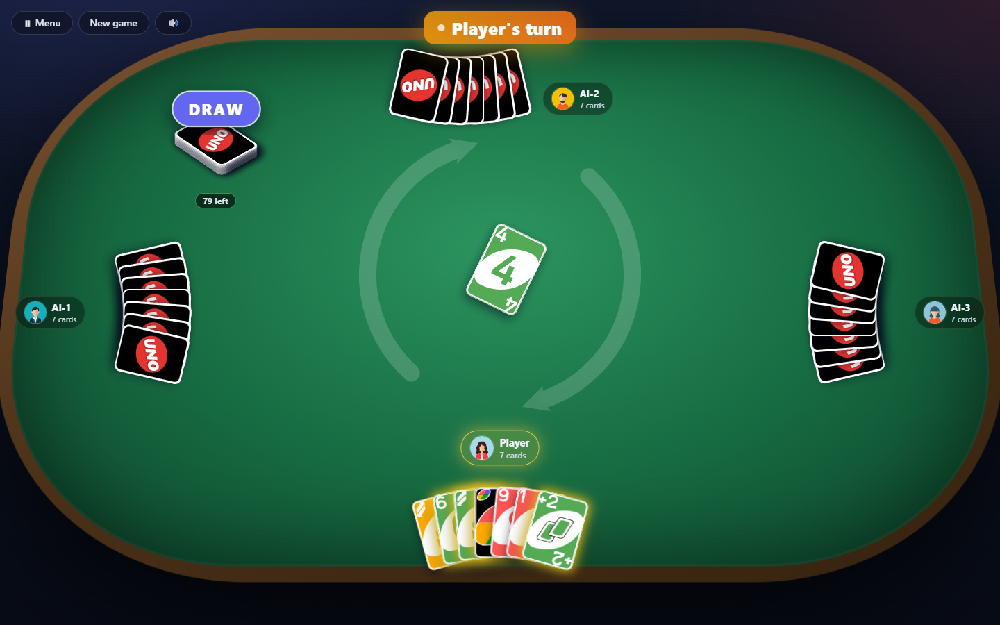

# UNO Web Game

A browser UNO card game with animated cards, sound, and save/load — play solo
against three AI opponents, or online with friends in a shared room joined by a
4-digit code. Rebuilt on a modern client-side stack.

**Live:** <https://troyyu527.github.io/uno-web-game>



## Tools & technologies

| Area | Used |
|---|---|
| Framework | **React 18** (function components + hooks) |
| Language | **TypeScript** (strict, with `noUnusedLocals`) |
| Build tool | **Vite 5** |
| State | **Zustand** — the game modelled as turn phases |
| Styling | **Tailwind CSS** |
| Animation | **Framer Motion** (`layout`, `AnimatePresence`) |
| Testing | **Vitest** — 66 unit tests, including fully simulated games |
| Backend *(optional)* | **Cloudflare Workers** — D1 (SQLite), Durable Objects, WebSockets |
| Deploy | GitHub Pages (static `dist/`) |

Single-player needs no backend at all — accounts and saves fall back to
`localStorage`. The Cloudflare Worker is only required for cloud accounts and online play.

## Quick start

```bash
npm install
npm run dev      # http://localhost:5173
```

Other scripts:

```bash
npm run build    # typecheck + production build to dist/
npm run preview  # serve the production build
npm run test     # run the engine + store unit tests (Vitest)
```

> If `npm run dev` reports a port other than 5173, an earlier dev server is still
> running — Vite silently moves to the next free port. Check the `Local:` line in
> its startup banner.

## How it's built

The game is split into a **pure, tested core** and a **thin UI**:

- `src/game/` — the UNO engine as plain, immutable TypeScript: `deck`, `rules`,
  `ai`, `types`. No React, no DOM. Covered by unit tests.

  It follows the official Mattel rules, including two that casual
  implementations usually drop: the **opening flip acts on the first player**
  (Draw Two → draw two and lose the turn, Skip → skipped, Reverse → direction
  flips), and after drawing, **only the drawn card** may be played that turn.
  Stacking +2 on +2 is a house rule and is not allowed, per the official rules.

  Three official rules are deliberately not implemented. **Wild Draw Four is
  playable on any turn** — officially it's legal only when you can't follow
  colour, but that restriction is only meaningful alongside the **challenge**
  mechanic (demand to see the hand; a bad play costs 4, a bad challenge 6),
  which needs interaction this game has no UI for. Likewise the penalty for
  failing to call UNO — the badge announces UNO for you.
- `src/store/gameStore.ts` — a **Zustand** store that models the whole game as
  turn phases (`playing` → `choosingColor` → `gameover`) and applies every rule
  (skip / reverse / draw-two / wild / draw-four, penalties, recycling the draw
  pile). Components read from it — no prop-drilling.
- `src/components/` + `src/routes/` — the React UI. Cards render from the
  original `UNO_cards_deck.svg` sprite sheet; animations are declarative
  **Framer Motion** (`layout` + `AnimatePresence`).
- `src/hooks/` — `useAIDriver` (runs AI turns), `useSound` (plays effects on
  store events), and `useOnlineGame` (keeps a client in step with a room).
- `src/lib/backend/` — a backend-agnostic auth + save/load layer with two
  adapters: **localStorage** (default, no setup) and **Cloudflare** (`src/lib/api.ts`).
- `src/lib/rooms.ts` — the multiplayer room API: REST calls plus a live WebSocket.
- `worker/` — the Cloudflare Worker: accounts, saves and rooms (see below).

The same `<Board>` renders both modes: it takes a `viewerSeat` and draws the
table from that seat's point of view, so online players each sit at the bottom
of their own screen.

## Playing online

The home page shows whether the server is actually reachable, and **Play Online**
is disabled unless it is. The check (`/health`) reads the database, so it also
catches a server whose schema was never migrated — you get told that on the
menu rather than at sign-up.

**Play Online → Create a room** gives you a 4-digit code to share; friends join
with **Play Online → Join**. Two to four players, and any empty seats are filled
by AI, so you never need a full table — a latecomer can take one of those AI
seats once the game is already running. Everyone needs an account, and online
play requires the Cloudflare backend (below) — the room is how the game is shared.

Online games can't be saved: the table lives in the room, shared by everyone at
it, so there's no single-player snapshot to write or restore. The in-game menu
offers save/load only in single-player.

How it works:

- Each room is a **Durable Object** holding the **entire game state**,
  republished after every move under a strictly increasing `version` and pushed
  to every client over a WebSocket. Clients apply anything newer than what
  they have, so a client that falls behind (or reloads) catches up in one step.
- **Exactly one client writes at a time**, which is what keeps that safe: the
  seat whose turn it is owns its own move, and the host owns everything nobody
  is sitting at — AI turns, deferred +2/+4 draws, and abandoned seats.
- **Seats change hands mid-game.** If a player goes quiet for 45s (presence is
  whoever has the room's socket open) the host hands their seat to the AI so the table isn't stuck;
  leaving outright releases it immediately. Anyone with the code can then drop
  into a seat the AI is holding, inheriting its hand. Claiming is atomic, so two
  people reaching for the same seat can't both get it.
- Rooms nobody has touched or connected to for 24 hours are deleted.
- **Reconnects** are seamless — refresh, or rejoin from the code, and you're
  back in your seat, AI-held or not.
- Move legality is enforced client-side, which is the right trade for a game you
  play with friends — a modified client could cheat. Making it cheat-proof means
  moving the rules into the room's Durable Object, sending each seat only its
  own hand.

## Accounts & save/load

Out of the box single-player works with **localStorage** — accounts and saved
games live in the browser, per device. No configuration required.

For cloud accounts, cross-device saves, and online play, run the
**Cloudflare Worker** in [`worker/`](worker/) and point the app at it.

## Server (Cloudflare)

| Piece | What it does |
|---|---|
| Worker (`worker/src/index.ts`) | REST API: `/auth/*`, `/saves/*`, `/rooms/*`, `/health` |
| D1 database `uno` (`worker/schema.sql`) | users (PBKDF2-hashed passwords) and game saves |
| Durable Object `RoomObject` (`worker/src/room.ts`) | one per room: state, atomic joins/claims, live WebSocket + presence |

Sign-in returns a signed token (HS256 JWT, 30 days) that the app keeps in
`localStorage` and sends as `Authorization: Bearer …`. There's no email
confirmation — signing up logs you straight in. Everything fits the Workers
free plan.

### Run it locally

```bash
echo "JWT_SECRET=$(openssl rand -hex 32)" > worker/.dev.vars   # any long random string
npm run db:migrate:local       # create the tables in the local D1
npm run api:dev                # Worker on http://localhost:8787
```

Then set `VITE_API_URL=http://localhost:8787` in `.env` and run `npm run dev`.

### Deploy it

```bash
npx wrangler login
npx wrangler d1 create uno               # paste the printed database_id into worker/wrangler.toml
npm run db:migrate                       # create the tables in the real D1
npx wrangler secret put JWT_SECRET -c worker/wrangler.toml   # paste a long random string
npm run api:deploy                       # prints https://uno-api.<you>.workers.dev
```

Put that URL in `.env` as `VITE_API_URL`, then rebuild and redeploy the site.
If the site is served from somewhere other than `https://troyyu527.github.io`,
add its origin to `ALLOWED_ORIGINS` in `worker/wrangler.toml` (CORS).

## Deploy

Static SPA — `npm run build` outputs `dist/`, deployable to GitHub Pages, Netlify,
Vercel, or any static host. `vite.config.ts` sets `base: "/uno-web-game/"` for
GitHub Pages; routing uses `HashRouter` so deep links work without server rewrites.
